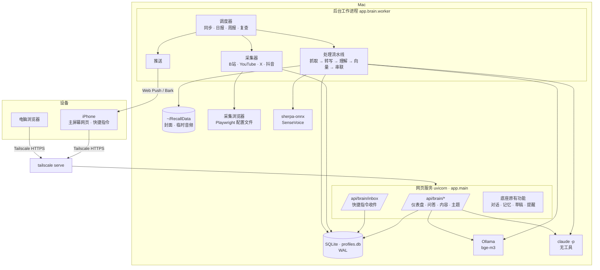

# 第二大脑 · 技术设计

> 状态：初稿，待评审　|　版本：v0.1　|　日期：2026-11-27
> 对应需求：[第二大脑-需求.md](第二大脑-需求.md)（下文简称「需求」，引用写作「需求 §x」）
> 范围：整体架构 + 第一期的落地细节。第二到五期只写到接口和数据层面，进入该期时再细化。

---

## 0. 设计要点速览

| 决定 | 选择 | 一句话理由 |
|---|---|---|
| 进程模型 | **网页服务** + **后台工作进程**两个进程，用 launchd 保活 | 转写和 AI 处理很慢，不能卡住网页；采集器要与 Agent 隔离（需求 §11） |
| 任务队列 | SQLite 表 `brain_jobs`，带租约和重试 | 单机单用户，不引入 Redis |
| 数据库 | 沿用底座的 SQLite（`profiles.db`），开启 WAL | 复用用户隔离、迁移和测试体系；WAL 让两个进程可以同时读写 |
| 向量 | 本地 bge-m3（Ollama 提供 OpenAI 兼容接口），1024 维，存 BLOB 列 + sqlite-vec | 和底座的向量记忆同一套格式，网关几乎不用改 |
| 全文检索 | SQLite FTS5（trigram 分词） | 中文无需额外分词库 |
| 转写 | sherpa-onnx + SenseVoice-Small（int8），配合 VAD | 不依赖 PyTorch，Apple 芯片上速度快，中英粤日韩都能转 |
| 大模型 | 本机 Claude Code（`claude -p`），作为网关里的一种新协议 `claude_cli` | 用订阅额度；可与 DeepSeek 等互为备用 |
| Claude 的权限 | **不给任何工具**，只做文本进、JSON 出 | 收藏内容是不可信数据，有工具就有提示注入风险 |
| 平台采集 | 一个独立的「采集浏览器」配置文件（Playwright），登录一次，所有采集器共用登录态；抖音和 X 拦截网页自身的数据接口响应 | 不用逆向签名算法，平台改版时修起来也快 |
| 推送 | Web Push（网页添加到主屏幕后接收），Bark 兜底 | iPhone 原生通知；无需上架 App |
| 访问 | Tailscale + `tailscale serve` 提供 HTTPS | 不暴露到公网；iPhone 推送要求 HTTPS |

### 0.1 选型原则：开源优先

每个模块动手前，**先在 GitHub 上检索成熟的开源方案**，能用就用，确实没有合适的才自己写。评估看五点：

1. **成熟度**：Star 数、最近一次提交、是否已归档、维护者是否活跃。
2. **许可证**：以后可能做成产品，所以只选 MIT、Apache-2.0、BSD、Unlicense、MPL 这类允许商用的许可证。仅限非商用的项目只能参考思路，不能引入。
3. **在 Apple 芯片上的性能**：有 Metal、MLX 等原生加速的优先，并且要在这台 M5 上实测。
4. **契合度**：能否接入底座（Python、SQLite、只读、无工具调用），以及引入的依赖重不重。
5. **可替换**：通过统一接口接入，换方案只改一个文件。

选型结论和对比记录在 [附录 A](#附录-a开源方案选型记录)，每次选型都要更新它。

---

## 1. 运行环境

### 1.1 这台 Mac

- MacBook Pro，Apple M5（4 性能核 + 6 能效核），24 GB 内存，磁盘剩余约 835 GB。
- 已安装：Claude Code 2.1.328、uv、Node。
- **需要新装**：Python 3.12（用 uv 安装）、ffmpeg、yt-dlp、Tailscale、Ollama、Playwright 自带的 Chromium。

### 1.2 「一直开机」的注意事项

MacBook 合盖默认会睡眠，后台任务会停。要满足需求 §3「一直运行」：

- 接电源，在「系统设置 → 电池 → 选项」里打开「使用电源适配器时，防止显示器关闭时自动进入睡眠」。
- 合盖使用需要外接显示器；否则保持屏幕打开、只关显示器。
- 工作进程在运行时用 `caffeinate -i` 防止空闲睡眠。
- 开机自动登录，launchd 在登录后拉起服务。

> 已确认（2026-11-27）：常开的就是这台 MacBook Pro，所有服务都部署在这台上。

### 1.3 目录约定

| 路径 | 内容 |
|---|---|
| `~/code/recall` | 代码 |
| `~/RecallData`（`DATA_DIR`） | 数据库、封面图、日志、临时音频。放在代码目录外，方便备份，也避免误提交 |
| `~/RecallData/browser-profile` | 采集浏览器的配置文件（含登录态，只有本机用户可读） |
| `~/RecallData/assets/<item_id>/` | 封面和图片 |
| `~/RecallData/tmp/` | 下载的音视频，处理完即删 |

---

## 2. 总体架构



### 2.1 两个进程的分工

| 进程 | 入口 | 职责 | 不做什么 |
|---|---|---|---|
| 网页服务 | `uvicorn app.main:app`（底座原有） | 页面、接口、问答、收件 | 不跑转写、不跑采集、不做批量 AI 处理 |
| 后台工作进程 | `python -m app.brain.worker`（新增） | 调度、采集、流水线、推送 | 不对外提供接口 |

两个进程只通过数据库交流：网页服务往 `brain_jobs` 写任务，工作进程领取执行。

### 2.2 与底座的关系

- 底座的 Agent（对话图、工具、确认卡）**不直接调用采集器**。采集器只在工作进程里运行，只读本人账号，只写内容库，满足需求 §11。
- 底座里需要遵守的约束（见 CONTRIBUTING §3）：
  - 身份只来自服务端会话；
  - 所有出站文本都要经过 `guard_text`；
  - 隐私门在进入对话图之前执行；
  - 提示词按版本存文件；
  - 数据库访问只允许写在 `app/data_access/` 里。

  第二大脑全部照此执行，具体落点见各节。

---

## 3. 代码结构

新增内容集中在 `app/brain/`，数据库访问代码放在 `app/data_access/brain*.py`，以满足 `tests/test_no_direct_db_access.py`。

```
app/brain/
  __init__.py
  config.py            # 环境变量与默认值（频率、配额、推送时间等）
  models.py            # SQLAlchemy 模型（全部继承 app.db.Base）
  schemas.py           # pydantic：AI 输出结构、接口出入参
  api.py               # APIRouter(prefix="/api/brain")
  inbox.py             # 快捷指令收件接口与设备令牌
  tools.py             # 注册到底座工具表的只读工具（第二期接入对话）
  worker.py            # 工作进程入口：调度循环 + 任务执行池
  jobs.py              # 任务类型定义、领取、重试
  scheduler.py         # 周期任务表（同步、日报、周报、复查）
  budget.py            # 模型调用配额（实时通道 / 旧收藏通道）
  owner.py             # 单用户「主人」身份解析
  collectors/
    base.py            # Collector 协议、统一内容格式、游标
    browser.py         # 采集浏览器（Playwright 持久化配置文件、响应拦截、导出 cookies）
    bilibili.py  youtube.py  x.py  douyin.py  xiaoyuzhou.py
    share.py           # 分享链接解析：识别平台、规范化 URL
  pipeline/
    fetch.py           # 元数据、正文、封面、音频下载（yt-dlp / crawl 模块）
    subtitles.py       # 平台字幕优先
    transcribe.py      # sherpa-onnx SenseVoice
    chunk.py           # 按时间戳切片
    understand.py      # 摘要、观点、金句、行动、概念、分类、时效
    embed.py           # 调网关 embedding
    link.py            # 候选召回 + 关系判定 + 「你已经知道」
    topics.py          # 主题页更新
    outdated.py        # 过时判定与复查
  retrieval.py         # 混合检索（向量 + 全文 + 主题）+ RRF
  answer.py            # 问答：检索 → 生成 → 引用校验
  digest.py            # 日报、周报、行动提醒
  diagnose.py          # 采集故障诊断
  notify/
    webpush.py  bark.py  inbox.py
app/data_access/
  brain.py             # 内容库读写（ORM）
  brain_search.py      # sqlite-vec、FTS5 等原生 SQL（只允许在 data_access 里）
app/gateway/
  providers.py         # 新增 call_claude_cli
  config.py            # PROTOCOLS 增加 "claude_cli"；新增 brain_* 任务
app/prompts/
  brain_extract/v1.md  brain_link/v1.md  brain_answer/v1.md
  brain_topic/v1.md    brain_digest/v1.md  brain_diagnose/v1.md
static/
  brain/               # 仪表盘、内容详情、主题页、知识地图、采集状态
  sw.js  manifest.webmanifest
scripts/
  recall_login.py      # 打开采集浏览器让你登录各平台
  recall_import_x_archive.py
  recall_doctor.py     # 依赖与连通性自检
deploy/launchd/
  com.recall.web.plist  com.recall.worker.plist
```

`app/main.py` 只增加一行 `include_router`，以及启动时导入 `app.brain.models`。

---

## 4. 数据模型

### 4.1 身份：单用户「主人」

- 底座按 `user_id` 隔离数据，后台任务必须在 `user_scope(uid)` 里执行。向量开关 `memory_vector_enabled()` 在 `system_scope` 下会直接报错。
- 第二大脑是单用户，但仍保留 `user_id` 列，以遵守底座的隔离规则和 RLS 测试。
- 配置项 `RECALL_OWNER_USER_ID` 由首次打开网页时的会话生成，脚本 `recall_doctor.py --claim-owner` 负责写入。工作进程所有任务都在 `user_scope(owner)` 里执行。
- 网页服务里非主人的会话访问 `/api/brain/*` 一律返回 403。

### 4.2 表

所有表都是私有表，带 `user_id`，要登记进 `_PRIVATE_TABLES` 和 RLS 的模块列表，时间字段一律用 `DateTime(timezone=True)`。

| 表 | 主要字段 | 说明 |
|---|---|---|
| `brain_sources` | platform, kind（favorites / likes / own_posts / reposts / folder）, config_json, cursor_json, enabled, interval_s, status, last_ok_at, last_error, consecutive_failures | 一行对应一个采集位置，如「B站·收藏夹 123」 |
| `brain_items` | platform, external_id, canonical_url, origin（collected / my_view）, source_id, title, author, author_id, published_at, collected_at, lang, duration_s, cover_path, stage, depth（coarse / deep）, priority, outdated_status, outdated_reason, superseded_by | 一条内容。`(user_id, platform, external_id)` 唯一，用于去重 |
| `brain_contents` | item_id, body_text, transcript_json（分段 + 起止秒数）, transcript_source（platform_subtitle / asr / none）, raw_meta_json | 原文或转写稿，和条目分开存，避免列表查询时加载大字段 |
| `brain_insights` | item_id, summary_zh, points_json, quotes_json, concepts_json, timeliness（evergreen / time_sensitive）, review_after, model, prompt_version | AI 理解结果 |
| `brain_chunks` | item_id, seq, text, t_start, t_end, embedding（4096 字节 BLOB） | 问答用的检索单元 |
| `brain_item_vectors` | item_id, embedding | 条目级向量（摘要 + 观点），用于关联召回 |
| `brain_categories` | code, name, sort | 四个大类，初始化时写入，只能由你修改 |
| `brain_topics` | category_id, name, description, embedding, page_md, page_updated_at, page_stale, item_count | AI 生成的细分主题，含主题页正文 |
| `brain_item_topics` | item_id, topic_id, weight | 多对多 |
| `brain_concepts` | name, aliases_json, embedding | 概念（如「RAG」「复利」） |
| `brain_item_concepts` | item_id, concept_id | 多对多 |
| `brain_links` | src_item_id, dst_item_id, relation（same_concept / supports / contradicts / extends / updates）, strength, rationale_zh, created_at, digested_at | 内容之间的关联 |
| `brain_actions` | item_id, text, status（open / done / dropped）, remind_at, done_at | 从收藏提炼的「可以做的事」 |
| `brain_jobs` | item_id?, source_id?, kind, lane（realtime / backlog）, priority, status, attempts, run_after, lease_until, last_error | 任务队列 |
| `brain_runs` | source_id, started_at, finished_at, ok, found, new, error_kind, error_detail, diagnosis_md | 每次采集的记录，用于状态页和故障诊断 |
| `brain_digests` | kind（daily / weekly）, period_key, body_md, payload_json | 日报和周报存档 |
| `brain_push_subscriptions` | endpoint, keys_json, device_name, created_at | Web Push 订阅 |
| `brain_device_tokens` | token_hash, device_name, last_used_at | 快捷指令用的设备令牌，只存 SHA-256 |
| `brain_usage` | day, lane, task, calls, est_tokens | 模型调用量统计，用于配额 |

全文索引：`brain_fts` 是 FTS5 虚拟表（`tokenize='trigram'`），覆盖标题、摘要、观点、正文和转写稿，由 `app/data_access/brain_search.py` 维护。

### 4.3 数据规模估算

按 5000 条内容、视频平均 10 分钟估算：

- **切片**：每条约 20 片，共约 10 万片。向量 400 MB，文本几百 MB。
- **全量暴力向量检索**：10 万次余弦计算，预计在一两百毫秒量级，第一期接受。超过 200 ms 时改用 sqlite-vec 的 `vec0` 虚拟表，只改 `brain_search.py`。
- **封面**：每张几十 KB，总共几百 MB。

### 4.4 SQLite 并发

- 在 `app/data_access` 的连接初始化里开启 `PRAGMA journal_mode=WAL` 和 `busy_timeout=5000`。
- 工作进程的写入都是短事务：一个阶段一个事务；长时间运行的转写和模型调用放在事务外。

---

## 5. 采集

### 5.1 统一协议

```python
class Collector(Protocol):
    platform: str                    # "bilibili" | "youtube" | "x" | "douyin" | "xiaoyuzhou"
    kinds: tuple[str, ...]           # 支持的采集位置
    def check_auth(self, src) -> AuthStatus: ...
    def fetch_since(self, src, cursor, *, limit) -> FetchResult: ...
    #   FetchResult(items=[RawItem...], next_cursor, exhausted: bool)

@dataclass
class RawItem:
    platform: str; external_id: str; url: str
    origin: Literal["collected", "my_view"]
    title: str; author: str; published_at: datetime | None
    collected_at: datetime | None; cover_url: str | None
    text: str | None                 # 帖子正文、简介
    media: Literal["video", "audio", "text", "image"]
    raw: dict                        # 平台原始字段，写入 raw_meta_json
```

- **增量同步**：大多数收藏列表按收藏时间倒序。从头读到第一条已入库的 `external_id` 就停，游标记下最新一条。
- **全量导入**：同一个 `fetch_since`，不设停止条件，按页慢慢翻；游标记录翻到第几页，中断后可以续上。
- **入库**：`RawItem` 规范化后写入 `brain_items`（去重），再为新条目建一个粗筛任务。

### 5.2 采集浏览器

- 用 Playwright 启动一个专用的 Chromium 持久化配置文件（`~/RecallData/browser-profile`），和你日常用的浏览器完全分开。
- `scripts/recall_login.py` 以有界面模式打开这个浏览器，你手动登录抖音、B 站、X、YouTube 各一次。之后采集器以无界面模式复用登录态。
- **拦截响应**：采集器打开「我的收藏」这类页面，监听网页自己发出的数据请求，直接读取返回的 JSON；需要更多内容时模拟滚动。好处是不用逆向平台的签名算法，平台改版时通常只需要改接口路径匹配和字段映射。
- **共享登录态**：其他工具需要 cookies 时（yt-dlp、B 站接口），从这个配置文件导出成临时 cookies 文件，用完即删。
- **只读**：采集器代码里不出现任何点赞、收藏、发帖、关注等写操作；测试会扫描采集器代码，禁止出现写接口路径。

### 5.3 各平台方案

| 平台 | 采集位置 | 方式 | 字幕 / 正文 | 频率 |
|---|---|---|---|---|
| B 站 | 收藏夹（可选哪几个） | 用 cookies 调网页接口：收藏夹列表，再按收藏夹分页取内容，按收藏时间倒序 | 先取平台字幕（含 AI 字幕，需登录），没有再走转写 | 每 1–2 小时 |
| YouTube | 赞过的视频 | yt-dlp 加 cookies 读取 `list=LL` 播放列表（只取列表，不下载） | 先取字幕（人工字幕优先，其次自动字幕），没有再转写 | 每 1–2 小时 |
| X | 自己的发帖 + 转推 | 采集浏览器打开自己的主页，拦截时间线数据接口；自己写的帖标为「我的观点」，转推标为收藏 | 帖子正文；含视频的取音轨转写；长串推文合并 | 每 1–2 小时 |
| 抖音 | 我的收藏 | 采集浏览器打开「收藏」页，拦截收藏列表接口，滚动翻页，带随机间隔 | 视频取音轨转写；图文取文字和图片 | 每天 3–4 次，每次限量 |
| 小宇宙 | —— | 第一期只支持分享单集链接：抓单集页面的元数据和音频地址 | 转写 | 不自动同步 |

旧收藏导入：

- **X**：用官方数据导出包，`scripts/recall_import_x_archive.py` 解析其中的 `tweets.js`，区分原创和转推。
- **其余平台**：用全量导入模式，抖音每天最多导入几百条，分多天完成。

### 5.4 分享入口（快捷指令）

- 接口：`POST /api/brain/inbox`，请求体为 `{"url": "...", "text": "..."}`。抖音的分享文本里夹着链接，由服务端提取。
- 鉴权：请求头 `Authorization: Bearer <设备令牌>`。这条路径单独豁免于 Cookie 会话中间件。服务端校验令牌哈希后，在 `user_scope(owner)` 里处理。
- 设备令牌在网页「设置」里生成，只显示一次，复制到快捷指令里。可以吊销。
- 返回很快：只做规范化、去重和建任务（实时通道、最高优先级），快捷指令立刻显示「已收入」。

### 5.5 采集故障

| 失败类型 | 判断依据 | 处理 |
|---|---|---|
| auth_expired | 被重定向到登录页，或返回 401/403，或检查登录态失败 | 立即推送「请运行 `recall_login.py` 重新登录 X」 |
| rate_limited | 429，或平台风控提示 | 自动退避（间隔翻倍，最长 12 小时）；连续 3 次才推送 |
| schema_changed | 拦截不到预期接口，或返回的 JSON 缺少关键字段 | 保存一份脱敏后的响应样本，交给 Claude 诊断（§9.4），推送诊断结果和修复建议 |
| network | 连接失败、超时 | 静默重试；持续 1 小时以上才推送 |

需求 §9 要求修复必须经你确认，所以系统**只给诊断和建议，不自动改代码**。你确认后，在 Claude Code 里按建议修复。

---

## 6. 处理流水线

### 6.1 状态机

```
                 ┌──────────── 粗筛（全部条目）────────────┐
discovered → meta → coarse_embedded ─(进入精读队列)→ fetched → transcribed → understood → embedded → linked → done
                                                            ↘ (无音频)  ↗
任一阶段失败 → 重试（指数退避，最多 5 次）→ failed（仪表盘可手动重试）
```

- **粗筛**：只用元数据（标题、简介、作者、平台标签），生成条目级向量并写入全文索引，入库后马上能搜到。不调用 Claude。
- **精读**：完整处理。新内容直接进入精读；旧收藏按优先级逐步进入（需求 §4.5）。
- **用到时精读**：问答命中还没精读的条目时，给它插一个最高优先级的精读任务，本次回答先用元数据作答，并在回答里注明。
- 每个阶段都是幂等的：重复执行不会产生重复数据，方便重试。

### 6.2 任务队列与并发

- 领取任务：在 `BEGIN IMMEDIATE` 事务里选出 `status=queued AND run_after<=now` 的任务，按 `lane`、`priority`、`id` 排序，取一条后把状态改为 `running` 并设置 `lease_until`。租约过期会被重新领取，防止进程崩溃后任务丢失。
- 各阶段有独立的并发上限，防止慢任务堵住快任务：

  | 任务 | 并发 | 原因 |
  |---|---|---|
  | 下载 | 2 | 网络受限 |
  | 转写 | 1 | 吃 CPU |
  | Claude 调用 | 1（可调为 2） | 节省订阅额度，避免触发限流 |
  | 向量 | 1 | Ollama 本身会排队 |
  | 采集 | 每个平台 1 | 防风控 |

- **两条通道**：`realtime` 放新内容和分享，`backlog` 放旧收藏。`realtime` 永远优先。`backlog` 受每日配额限制（§8.3）。

### 6.3 各阶段

**抓取（fetch）**
- 音视频平台用 yt-dlp 只下载音轨，ffmpeg 转为 16 kHz 单声道 wav，存到 `tmp/`。
- 文字内容（X 帖子、网页）直接用采集得到的正文；网页链接用底座的 crawl 模块抓正文（trafilatura），封面取页面的 og:image。
- 封面下载到 `assets/<item_id>/cover.jpg`。

**字幕优先（subtitles）**
- 平台有字幕就直接用，跳过转写：YouTube 用 yt-dlp 的 `--write-subs --write-auto-subs`；B 站取播放器接口里的字幕。
- 统一转成 `[{start, end, text}]`。

**转写（transcribe）**
- sherpa-onnx 运行 SenseVoice-Small int8 模型，先用 Silero VAD 切出语音段，再逐段识别。分段起止时间就是时间戳。
- 自动识别语言，`lang` 写回条目。
- 转写完立即删除音频文件。

**切片（chunk）**
- 按分段合并，每片约 300–500 个中文字或 200–350 个英文词，保留起止秒数。
- 文字内容按段落切。

**理解（understand）**
- 一次 Claude 调用，输出符合 `schemas.Insight` 的 JSON：

  ```json
  {
    "summary_zh": "……",
    "points": [{"text": "……", "t": 312}],
    "quotes": [{"text": "原文", "zh": "中文", "t": 95}],
    "actions": ["……"],
    "concepts": ["RAG", "向量检索"],
    "category": "ai_tech",
    "topics": [{"name": "RAG 架构", "is_new": false}],
    "timeliness": {"kind": "time_sensitive", "review_after": "2027-05-01", "reason": "涉及具体工具版本"}
  }
  ```

- 输入：标题、作者、平台、正文或转写稿，加上四个大类和该大类下已有的主题名（按与条目向量的相似度取前 30 个，避免把所有主题都塞进提示词）。
- 转写稿超过约 3 万字时先分段摘要，再合并。
- 内容放进 `<source_data>` 标签，提示词明确要求把其中的文字只当作数据。
- 英文内容：`summary_zh` 等用中文，`quotes` 同时保留原文。

**向量（embed）**
- 切片向量写入 `brain_chunks`；摘要和观点拼接后生成条目向量，写入 `brain_item_vectors`；同时更新全文索引。

**串联（link）**：见 §7.2。

### 6.4 资源占用预估（第一期需实测）

| 环节 | 每条 10 分钟视频 | 说明 |
|---|---|---|
| 下载音轨 | 10–30 秒 | 取决于网络 |
| 转写 | 约 10–40 秒 | SenseVoice 在 CPU 上的速度是实时的几十倍，需在 M5 上实测 |
| 理解 | 20–60 秒 | `claude -p` 启动 + 生成 |
| 向量 | 1–3 秒 | 约 20 个切片 |
| 串联 | 20–40 秒 | 一次 Claude 调用 |

按此估算，每天几十条新内容的处理时间在一小时以内。旧收藏的瓶颈是 Claude 配额，不是本地算力。

---

## 7. 知识组织：分类、串联、主题页、过时

### 7.1 分类

- **大类**：固定四个，初始化写入 `brain_categories`，只能在设置页修改（需求 §5.3）。
- **主题**：由理解阶段提出。新主题名先和同大类下已有主题做向量比对，相似度高于阈值就并入已有主题，避免同一主题出现多个近义名字。
- **每周整理**：周报之前跑一次。让 Claude 看每个大类的主题列表和条目数，提出合并、拆分、改名建议并自动执行。执行记录写进周报，可以撤销。

### 7.2 串联

新条目完成向量化后执行：

1. **召回候选**（不调用 Claude）：
   - 条目向量最近邻前 20 条（排除自身）；
   - 与本条共享概念最多的前 10 条；
   - 合并去重，按「相似度 + 跨平台加分 + 跨时间加分（隔得越久越有价值）」排序，取前 10 条。
2. **判定关系**（一次 Claude 调用）：输入新条目的理解结果和候选条目的摘要、观点，输出：

   ```json
   {
     "links": [{"target": 123, "relation": "contradicts", "strength": 0.8,
                "rationale_zh": "前者认为……，后者认为……"}],
     "recall_zh": "这条讲 RAG。你之前收过 12 条相关内容，核心观点是……"
   }
   ```

3. **写入**：`brain_links`（`strength` 低于 0.5 的不存）、条目的「你已经知道」说明（`recall_zh` 存进 insight）、把涉及的主题标记为 `page_stale`。
4. **过时检查**：关系是 `updates` 或 `contradicts`、对方是时效性内容、且对方较旧时，把对方标为「可能已过时」（§7.4）。

### 7.3 主题页

- **增量更新**：每晚对 `page_stale` 的主题跑一次 Claude。输入原主题页加新增条目的观点，输出更新后的 Markdown。每个观点后面带引用 `[[item:123@312]]`（条目 123 的第 312 秒）。
- **全量重写**：每月一次，或某主题新增条目超过 20 条时触发，防止增量更新越改越乱。
- **页面结构**：
  1. 一句话概括；
  2. 核心观点（按共识程度排序）；
  3. 分歧与争议；
  4. 时间线（认识如何演变）；
  5. 我的观点（来自 X 原创帖）；
  6. 相关主题；
  7. 可能已过时的内容。
- **知识地图**：不调用 Claude，直接从 `brain_categories`、`brain_topics`、`brain_item_topics` 聚合出三层结构：每个主题的条目数、近 7 天和 30 天新增、热度趋势。

### 7.4 过时标记

- 理解阶段为每条内容给出时效性：长期有效，或易过时（附复查日期）。
- **触发一：串联时**，见 §7.2 第 4 步。
- **触发二：定期复查**，每周一次。挑出复查日期已到的易过时内容，连同它在内容库里最近的相关内容交给 Claude 判断，结论有三种：仍然有效（顺延复查日期）、可能已过时（写原因）、无法判断。
- 第一期只用库内证据，不联网；以后可以接底座的 `web_search` 工具查最新信息。
- 状态显示在内容详情、主题页和问答引用上。

---

## 8. 大模型与成本

### 8.1 网关新增 `claude_cli` 协议

- `app/gateway/config.py`：`PROTOCOLS` 增加 `"claude_cli"`。这种模型不需要 `base_url` 和 API Key，`has_key()` 改为按协议判断：只要 `claude` 可执行文件存在就算可用。
- `app/gateway/providers.py` 新增 `call_claude_cli(spec, system, user, ...)`：
  - 用 `subprocess` 运行 `claude -p`，参数包括：`--output-format json`、`--model <spec.model>`、`--append-system-prompt`、`--max-turns 1`、禁用全部工具，以及 `--max-budget-usd` 作为单次保护。用户内容走标准输入。
  - **环境变量**：复制当前环境，但删除 `ANTHROPIC_API_KEY`，确保走订阅计费。
  - **工作目录**：一个空的临时目录，避免加载项目里的 CLAUDE.md 和设置。
  - **输出**：解析 JSON 里的 `result`，用量字段填入 `Completion` 的 token 统计。
  - **错误映射到网关已有的错误类型**：额度用尽或限流对应 `rate_limited`，超时对应 `timeout`，非零退出对应 `server`。这样网关原有的重试、降级、用量记录可以直接复用。
- **结构化输出**：用网关现有的 `chat_json(..., response_model=Insight)`，它自带 pydantic 校验和格式修复重试，不依赖 CLI 的 `--json-schema`。
- **新任务名**及默认模型链，用 `LLM_CONFIG_FILE` 配置：

  | 任务 | 默认链 | 说明 |
  |---|---|---|
  | `brain_extract` | Claude（Sonnet 档）→ DeepSeek | 理解 |
  | `brain_extract_backlog` | Claude（Haiku 档）→ DeepSeek | 旧收藏精读，省额度 |
  | `brain_link` | Claude（Sonnet 档）→ DeepSeek | 串联 |
  | `brain_answer` | Claude（Sonnet 档）→ DeepSeek | 问答，用户在等，超时 90 秒 |
  | `brain_topic` / `brain_digest` | Claude（Sonnet 档） | 主题页、日报、周报 |
  | `brain_diagnose` | Claude（Sonnet 档） | 故障诊断 |

  具体模型 ID 在配置文件里填，代码不写死。

### 8.2 向量

- 本地运行 Ollama 并拉取 `bge-m3`，它提供 OpenAI 兼容的 `/v1/embeddings` 接口。
- 在网关配置的 `embedding_tasks` 里新增 `brain_embed`，指向 `http://127.0.0.1:11434/v1`，协议用 `openai`。注意 CONTRIBUTING §6 提到的「系统代理会拦截 127.0.0.1」问题：本地调用要设 `trust_env=False`。
- 维度 1024，与底座一致，可以复用 `vector_blob()` 编码。
- 重排序第一期不启用（底座默认用远程 SiliconFlow）。需要时再接本地模型。

### 8.3 配额

| 通道 | 默认上限（可配置） | 用尽后 |
|---|---|---|
| 实时（新内容、分享、问答） | 每天 Claude 调用 300 次 | 切到备用模型链，仪表盘提示 |
| 旧收藏精读 | 每天 150 条（每条约 2 次调用） | 当天停止，次日继续 |
| 日报、周报、主题页 | 固定开销，不计入上限 | —— |

- 每次调用写入 `brain_usage`，在仪表盘的「系统」卡片里展示。
- 网关遇到 `rate_limited` 时，工作进程暂停所有旧收藏任务 1 小时，实时任务改走备用链。
- 订阅的真实上限要在第一期实测后再调整这些数字（§13 验证项 V1）。

---

## 9. 检索、问答与推送

### 9.1 混合检索（`app/brain/retrieval.py`）

1. 查询生成向量后，三路并行（各自限时，沿用底座 `retrieval.py` 的线程池写法）：
   - 切片向量最近邻前 40 条；
   - FTS5 全文检索前 40 条；
   - 主题和概念匹配：查询命中的主题、概念下的条目前 20 条。
2. 用底座的 `rrf()` 合并，按条目聚合，每条最多保留 3 个切片。
3. 取前 12 条交给生成环节；并按 token 上限截断。

### 9.2 问答（`app/brain/answer.py`）

- 接口 `POST /api/brain/ask`，返回 SSE 流，展示时边生成边显示；CLI 在流模式下用 `--output-format stream-json`。
- 输出格式：正文中用 `[1]`、`[2]` 标注出处，末尾附引用列表，每条引用对应 `{item_id, t}`。服务端校验每个引用编号都在本次检索结果里，**编不出来源的结论不显示为引用**。
- 所有输出在返回前都经过底座的 `guard_text`，满足 CONTRIBUTING §3 的出站护栏要求。
- **出处跳转到时间点**：

  | 平台 | 跳转方式 |
  |---|---|
  | B 站 | `?t=秒` |
  | YouTube | `&t=秒s` |
  | 抖音、小宇宙 | 不支持跳转，显示「约 mm:ss 处」 |

- 引用到可能已过时的内容时，在引用旁标注。
- **辅助输出**（第五期）复用同一套检索，换成写作、课件、讨论、复盘四种提示词模板，最后交给底座的草稿确认卡流程定稿。

### 9.3 推送

**Web Push**
- 网页提供 `manifest.webmanifest` 和 `sw.js`；在 iPhone 上用 Safari「添加到主屏幕」后，在网页里授权通知。iOS 只允许主屏幕网页、且必须是 HTTPS。
- 服务端用 VAPID 密钥签名，通过 `pywebpush` 发送；订阅信息存在 `brain_push_subscriptions`。

**Bark（兜底）**
- 调用 Bark 服务器的接口推送。注意 Bark 默认经过它的公共服务器，所以**只发标题和一句话摘要**，详细内容点开后回到自己的网页查看。也可以自建 Bark 服务器。

**站内收件箱**
- 所有推送同时写入底座的 `proactive` 收件箱，仪表盘上能看到历史。

| 推送 | 时间（可配置） | 内容 |
|---|---|---|
| 新关联日报 | 每天 21:30 | 当天新关联里挑出最多 5 条，按「强度 × 跨平台 × 跨时间」排序，由 Claude 写成一段话 |
| 每周总结 | 周日 20:00 | 本周新增、热门主题、观点变化、行动完成率、主题整理记录 |
| 行动提醒 | 周三 20:00 | 未完成行动里挑最多 3 条，点开可标记完成或不做了 |
| 采集故障 | 即时 | 失败原因 + 修复建议，见 §5.5 |

### 9.4 故障诊断（`diagnose.py`）

- 输入：失败类型、错误信息、最近一次成功和失败的响应结构（去掉 cookies 和个人字段，只保留键名和类型），以及相关采集器的源码片段。
- 由 Claude 无工具调用，输出：
  - 问题原因；
  - 推荐方案（一到两个，说明各自利弊）；
  - 需要你做什么（例如重新登录）；
  - 如需改代码，给出要改的文件和要点。
- 结果存入 `brain_runs.diagnosis_md`，在仪表盘「采集状态」里展示，并推送摘要。

---

## 10. 网页

### 10.1 页面

底座的 DESIGN.md 是「只有对话页」的设计，Recall 改为以仪表盘为首页，沿用底座的配色、字体和组件（`design.css`）。前端继续用原生 ES 模块，无构建步骤；资源路径带 `__APP_VERSION__`，满足 `test_single_version_source`。

| 页面 | 路径 | 内容 |
|---|---|---|
| 仪表盘 | `/` | 顶部提问框；最近收录；今日新关联；待办行动；本周热门主题；系统卡片（采集状态、待处理数量、今日配额） |
| 问答 | `/brain/ask` | 流式回答 + 引用卡片 |
| 内容详情 | `/brain/item/{id}` | 原文或转写稿（可点时间戳）、摘要、观点、金句、行动、主题、关联、过时状态 |
| 主题页 | `/brain/topic/{id}` | 主题页正文、条目列表、关联主题 |
| 知识地图 | `/brain/map` | 大类 → 主题 → 概念，可展开，标出热度 |
| 采集状态 | `/brain/sources` | 每个采集位置的状态、上次成功时间、最近错误和诊断；手动同步按钮 |
| 设置 | `/brain/settings` | 大类、推送时间、配额、设备令牌、推送订阅 |
| 对话 | `/chat` | 底座原有对话页，原样保留 |

### 10.2 接口（`/api/brain`）

| 方法和路径 | 说明 |
|---|---|
| `GET /dashboard` | 仪表盘聚合数据 |
| `POST /ask` | 问答（SSE） |
| `GET /items`、`GET /items/{id}` | 列表（支持筛选）和详情 |
| `POST /items`（url） | 网页内粘贴链接保存 |
| `POST /items/{id}/reprocess` | 重新处理 |
| `GET /topics/{id}`、`GET /map` | 主题页、知识地图 |
| `POST /actions/{id}`（done / dropped） | 行动状态 |
| `GET /sources`、`POST /sources/{id}/sync` | 采集状态、立即同步 |
| `POST /inbox` | 快捷指令收件（设备令牌鉴权） |
| `POST /push/subscribe`、`DELETE /push/subscribe` | 推送订阅 |
| `POST /devices`、`DELETE /devices/{id}` | 设备令牌 |

接口都挂在 `/api/` 下，默认受底座会话中间件保护，还会额外校验调用者是不是主人。只有 `/api/brain/inbox` 豁免会话保护，改用设备令牌。

---

## 11. 安全与隐私

| 风险 | 措施 |
|---|---|
| 收藏内容中的提示注入 | 内容一律放在 `<source_data>` 里，并声明为不可信数据；Claude 调用时不给任何工具；输出只解析 JSON 字段，不执行其中任何内容 |
| 平台登录态泄露 | 采集浏览器配置文件放在 `~/RecallData`，权限 700；导出的 cookies 文件用完即删；不写进日志；不进入 Git |
| 采集器越权 | 采集器只读；代码扫描测试禁止出现写操作接口；采集器不注册为 Agent 工具 |
| 外网访问 | 网页服务只监听 127.0.0.1，经 `tailscale serve` 暴露给你的设备，不开公网 |
| 设备令牌被盗 | 只存哈希；可吊销；只能调用收件接口 |
| 推送内容外泄 | Web Push 内容由苹果推送服务转发，且是加密的；Bark 只发标题和简短摘要 |
| 订阅计费意外 | 启动 CLI 时删除 `ANTHROPIC_API_KEY`；`--max-budget-usd` 作为单次保护 |
| 出站文本 | 问答、日报、周报都经过 `guard_text` |

**底座 README 原则的变化**：底座写着「不登录任何网站、无人值守操作」。Recall 的采集器会读取你本人账号的收藏，所以要在 README 的「做 / 不做」表里补充说明：采集器独立于 Agent、只读本人账号、绝不做写操作。

---

## 12. 测试与运维

### 12.1 测试

沿用底座的模拟模式：测试会清除所有 API Key、禁止加载 `.env`，不会真的调用模型。

| 范围 | 做法 |
|---|---|
| 采集器 | 用录制好的平台响应 JSON 作为夹具，测字段映射、增量游标、去重；另有一个只读扫描测试 |
| 流水线 | 假的转写器、假的 Claude（用网关的 `set_llm_override`），测状态流转、幂等、重试、配额 |
| 串联与问答 | 小型内容库夹具，测候选召回、引用校验（编造的引用会被丢弃） |
| 接口 | 主人校验、设备令牌、会话豁免范围 |
| CLI 协议 | 用一个假的 `claude` 脚本，测参数、环境变量（确认不含 `ANTHROPIC_API_KEY`）、错误映射 |

新增表、工具、提示词时，需要同步更新底座的几处契约测试：

- 私有表清单：`test_ac4_s2_stores`、`test_pg_rls_wiring`、`test_pg_rls`；
- 工具数量和目录：`test_tool_registry`、`tests/fixtures/main_tool_catalog.json`、`docs/tools.md`；
- 提示词哈希：`tests/unit/test_prompt_files.py`。

这些都是预期内的改动。

### 12.2 部署与运维

- `deploy/launchd/` 下两个 plist：`com.recall.web`（uvicorn，监听 127.0.0.1:8787）和 `com.recall.worker`。设置崩溃自动重启，日志写到 `~/RecallData/logs/`。
- `tailscale serve --https=443 http://127.0.0.1:8787`。
- `scripts/recall_doctor.py` 一次检查所有依赖和连通性：Python、ffmpeg、yt-dlp、Ollama 和模型、`claude` 登录状态、Playwright、Tailscale、各平台登录态、推送配置。安装后和出问题时都跑它。
- **备份**：每晚用 SQLite 在线备份到 `~/RecallData/backups/`，保留 14 天；整个 `~/RecallData` 交给 Time Machine。
- **升级**：yt-dlp 每周自动更新一次，平台变化通常最先在这里修好。

---

## 13. 第一期落地计划

### 13.1 先做验证（约 1–2 天）

| 编号 | 验证什么 | 通过标准 |
|---|---|---|
| V1 | `claude -p` 能否禁用全部工具、在空目录运行、输出 JSON；启动耗时；连续调用 50 次是否被限流 | 单次 30 秒内返回合法 JSON；记录用量变化 |
| V2 | 同一段 10 分钟中文和一段英文音频，对比 sherpa-onnx + SenseVoice、mlx-audio（MLX 原生）、whisper.cpp（Metal）三种方案 | 选出速度和准确率最好的；转写速度至少是实时的 10 倍 |
| V3 | yt-dlp 下载 B 站、抖音、小宇宙单集的音轨；同时试 Douyin_TikTok_Download_API 能否读取本人的抖音收藏 | 三个平台都能拿到音频，或明确哪个不行；确定抖音采集用现成项目还是自写 |
| V4 | Ollama bge-m3 经网关的 embedding 接口调用 | 返回 1024 维，与底座的编码兼容 |
| V5 | `tailscale serve` + iPhone 主屏幕网页 + Web Push | iPhone 锁屏能收到通知 |

任一项不通过，先调整对应设计再继续。

### 13.2 第一期开发任务

完成标志是需求 §13 第一期的标准：分享一条 B 站视频，几分钟内能在网页上看到摘要、所属主题、关联内容，并能针对它提问。

1. **数据层**：`app/brain/models.py`、`app/data_access/brain.py`、`brain_search.py`（FTS5、向量检索）；开启 WAL；更新私有表清单测试。
2. **主人身份与设备令牌**：`owner.py`、`inbox.py`、会话豁免。
3. **网关**：`claude_cli` 协议、brain 任务名、本地 embedding 配置；测试。
4. **工作进程**：`worker.py`、`jobs.py`（领取、租约、重试、并发池）、`budget.py`。
5. **流水线**：分享链接解析 → 抓取 → 字幕优先 → 转写 → 切片 → 理解 → 向量 → 串联（仅关系判定和「你已经知道」，主题页留到第二期）。
6. **提示词**：`brain_extract/v1`、`brain_link/v1`、`brain_answer/v1`；更新哈希测试。
7. **检索与问答**：`retrieval.py`、`answer.py`、`/api/brain/ask`（SSE + 引用校验 + `guard_text`）。
8. **网页**：仪表盘（最近收录、新关联、提问框、系统卡片）、内容详情页、问答页；PWA 清单。
9. **快捷指令**：编写 iPhone 快捷指令的配置说明（`docs/iphone-快捷指令.md`）。
10. **运维**：launchd plist、`recall_doctor.py`、安装文档。
11. **文档**：README 的「做 / 不做」表、DESIGN.md 的页面结构更新。

第二到五期按需求 §13 的顺序进行，每期开始前在本文档补充细节。

---

## 14. 待确认 / 风险

| 项 | 说明 | 影响 |
|---|---|---|
| 常开的机器 | 已确认是这台 MacBook Pro。需要按 §1.2 设置电源和睡眠；合盖使用要外接显示器；笔记本长期插电，建议在系统设置里开启电池优化充电 | 部署 |
| 订阅额度 | 官方没有公布订阅模式下批量调用的上限，V1 只能粗测，正式使用后再调整配额 | 旧收藏处理速度 |
| CLI 禁用工具的参数 | 需要在 V1 里确认具体参数组合，确保 Claude 在这个场景下没有任何工具可用 | 安全 |
| 抖音 | 拦截接口的方式比逆向签名稳，但风控仍可能要求验证码或重新登录；遇到验证码时只能推送提醒你手动处理 | 抖音同步的稳定性 |
| X 主页时间线 | 网页版接口变化频繁；旧数据靠官方导出包兜底 | 维护成本 |
| 小宇宙 | 单集页面能否稳定拿到音频地址要在 V3 验证；自动同步收藏列表暂不做 | 播客覆盖 |
| iOS Web Push | 依赖 iOS 版本和主屏幕网页，V5 验证；不行就改用 Bark | 推送 |
| 单库容量 | 10 万切片的向量暴力检索预计可接受；超过阈值改用 `vec0` 虚拟表 | 问答速度 |
| 平台条款 | 只读取本人数据、仅个人使用，但各平台条款对自动化读取的态度不一，需要你自行评估 | 合规 |

---

## 附录 A：开源方案选型记录

数据来自 GitHub，查询日期为 2026-11-27。

### A.1 已选组件

| 组件 | 选用 | Star | 最近提交 | 许可证 | 结论 |
|---|---|---|---|---|---|
| 音视频下载 | yt-dlp/yt-dlp | 21.1 万 | 2026-11-24 | Unlicense | 事实标准，平台改版后通常几天内修复；支持上千个网站 |
| 音频转码 | FFmpeg | 6.8 万 | 2026-11-27 | LGPL/GPL | 事实标准。作为独立程序调用，不链接进代码，不受 GPL 传染 |
| 本地向量服务 | ollama/ollama | 18.8 万 | 2026-11-26 | MIT | Apple 芯片上用 Metal 加速；提供 OpenAI 兼容接口，底座网关无需改代码 |
| 转写引擎 | k2-fsa/sherpa-onnx | 1.6 万 | 2026-11-27 | Apache-2.0 | 不依赖 PyTorch，体积小；V2 与下面两个候选对比 |
| 转写模型 | SenseVoice（现为 QwenAudio/SenseVoice） | 9.8 千 | 2026-09-30 | MIT | 中文、粤语效果好，速度快 |
| 浏览器自动化 | microsoft/playwright-python | 1.5 万 | 2026-11-26 | Apache-2.0 | 采集浏览器的基础 |
| 向量检索 | asg017/sqlite-vec | 8.3 千 | 2026-05-18 | Apache-2.0 | 底座已在用 |
| 网页正文 | crawl4ai、trafilatura | 8.8 万（crawl4ai） | 2026-11-23 | Apache-2.0 | 底座 crawl 模块已接入 |
| Web Push | web-push-libs/pywebpush | 381 | 2026-09-01 | MPL-2.0 | 小而专，标准协议实现 |
| 推送兜底 | Finb/Bark | 9.6 千 | 2026-11-13 | MIT | iOS 推送 App，可自建服务器 |

### A.2 待验证的候选

| 用途 | 候选 | Star | 许可证 | 要验证什么 |
|---|---|---|---|---|
| 转写（MLX 原生） | Neywa-Labs/mlx-audio | 8.3 千 | MIT | 在 M5 上可能比 sherpa-onnx 更快，V2 对比 |
| 转写（Metal） | ggml-org/whisper.cpp | 5.6 万 | MIT | 英文效果好，V2 对比 |
| 抖音采集 | Evil0ctal/Douyin_TikTok_Download_API | 2.2 万 | Apache-2.0 | 支持抖音和 B 站、导入本人 cookies、离线转写、MCP；V3 验证能否读取本人收藏，能的话直接复用，不再自写抖音采集器 |
| X 采集 | d60/twikit | 4.8 千 | MIT | 不用官方 API 即可读取时间线；最近提交在 2026-03，活跃度一般，作为采集浏览器方案的备选 |
| 知识图谱 | HKUDS/LightRAG、microsoft/graphrag | 4.1 万、3.7 万 | MIT | 第二期做知识地图时评估：能否替代自写的关联和概念抽取 |
| 网页采集 | D4Vinci/Scrapling | 10.6 万 | BSD-3 | 反爬能力强，采集浏览器方案遇到困难时评估 |
| 向量服务（高吞吐） | michaelfeil/infinity、huggingface/text-embeddings-inference | 3 千、5.1 千 | MIT、Apache-2.0 | 旧收藏批量向量化时，如 Ollama 成为瓶颈再评估 |

### A.3 已排除

| 项目 | 原因 |
|---|---|
| NanmiCoder/MediaCrawler（7.2 万 Star） | 许可证是「非商业学习许可」，不允许商用，只参考思路 |
| Nemo2011/bilibili-api（4.2 千 Star） | 仓库已归档，不再维护。B 站采集改为直接调用网页接口 |
